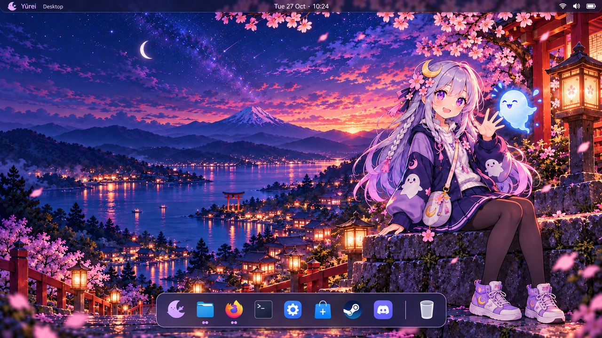
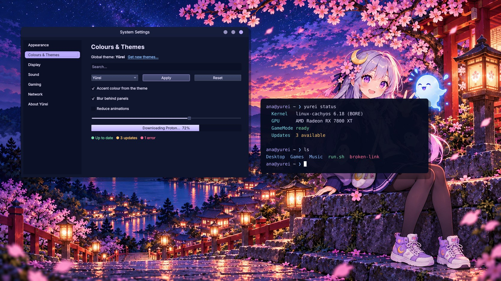
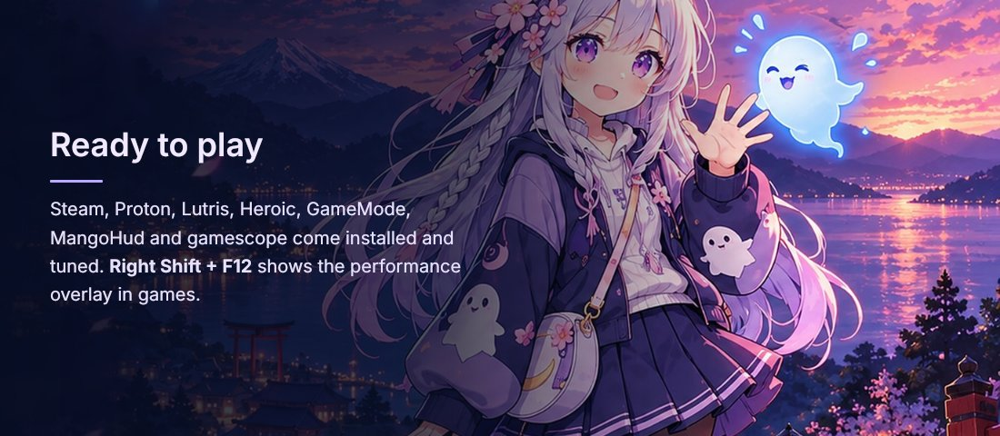

# Boot animation, login screen and desktop

Yūrei's branding has two themes, each in its own package, plus a Plasma
splash, a default desktop (see [The desktop](#the-desktop) below), and the
live ISO and installer (see [The live ISO and the installer](#the-live-iso-and-the-installer)):

| Package | What it is | Turn on / off |
|---|---|---|
| `yurei-plymouth-theme` | Boot and shutdown animation: the mascot spots a spirit, chases it, leaps, catches it and waves beside the wordmark. The wave loops for as long as booting takes. | `yurei bootsplash on` / `off` |
| `yurei-sddm-theme` | Login screen: moonlit shrine and sakura, the mascot, the new wordmark, and real controls (password, "Switch user" with an account list, session menu, keyboard layout, sleep/restart/shut down). Accounts without their own picture get the design's moon-over-torii avatar. | `yurei login-screen yurei` / `plasma` |

After you log in, Plasma's start-up splash carries the boot animation on:
the same waving loop, at the same size and place on the same navy, with a
thin progress bar. It comes with `yurei-settings` (selected in
`/etc/xdg/ksplashrc`; pick another in System Settings > Colours & Themes >
Splash Screen).

New installs from the Yūrei ISO get both themes automatically. The installer step
runs the two commands above, and if either fails, the installation still
completes.

| Boot | Disk unlock | Login |
|---|---|---|
|  |  |  |

## The desktop



*The approved design. The real desktop is built from Plasma's own widgets,
so details like fonts and icon artwork follow the system theme.*

`yurei-settings` sets up this desktop for new users:

* **Wallpaper:** the mascot sitting on the shrine steps
  (`/usr/share/wallpapers/Yurei`, at 1672×941 and 3344×1882; Plasma picks the
  closer size). The lock screen uses it too, via `/etc/xdg/kscreenlockerrc`.
* **Top bar:** slim and translucent. On the left, the Yūrei menu (the
  moon-ghost icon and "Yūrei") and the focused app's menus, as on macOS. The
  date and time sit in the centre ("Tue 27 Oct · 10:24"), and the system tray
  (Wi-Fi, volume, battery) on the right.
* **Dock:** floating, centred, sized to its icons, and it steps aside when a
  window covers it. From left to right:
  * the full-screen app grid
  * Files, Firefox, Terminal, Settings, Discover (app store), Steam and Discord
  * running apps, with dots underneath
  * a separator, then the Trash

  Apps that aren't installed are left out automatically.
* **Icon:** the moon-ghost mark (`branding/icon.svg`), used for the menu, the
  app grid and the system logo.

**How it's applied.** CachyOS gives every new user a single bottom panel, by
copying `/etc/skel/.config/plasma-org.kde.plasma.desktop-appletsrc` from
`cachyos-kde-settings`. Rather than fight over that file, Yūrei ships a
Plasma *update script*
(`/usr/share/plasma/shells/org.kde.plasma.desktop/contents/updates/yurei-desktop-layout.js`).
Plasma runs it once per user at their first login. It replaces the layout
only if it is still that untouched stock panel, so anyone who has arranged
their own panels keeps them.

**Switching any time** (as yourself, in your Plasma session):

```sh
yurei layout dock      # top bar and dock
yurei layout classic   # CachyOS's single bottom panel
```

## Colours: the Yūrei global theme



*The palette on Qt widgets over the wallpaper (`branding/preview-theme.py`).
The real desktop draws its own window borders, panels and fonts.*

`yurei-settings` ships a Plasma global theme, **Yūrei**
(`/usr/share/plasma/look-and-feel/org.yurei.desktop`), which bundles:

| Part | What it is |
|---|---|
| Colours | `Yurei.colors`: navy windows and panels (`#10162e`, views `#0b1026`), lavender selection and focus (`#b9aaff`), light lavender text (`#e6e1ff`); sakura pink for errors, lantern gold for warnings, mint for success, spirit blue for links |
| Window borders | Breeze, coloured by the scheme: navy title bars |
| Splash | the waving mascot after login (above) |
| Wallpaper | the mascot on the shrine steps |
| Icons, cursor, widgets | Breeze Dark icons, Breeze cursor and widget style |
| Desktop layout | the top bar and dock, applied only if you tick *Use desktop layout from theme* |

Konsole gets a matching **Yūrei** profile (navy background, lavender prompt
colours, slight transparency), set as the default in `/etc/xdg/konsolerc`.

**How it becomes the default.** CachyOS gives every new account Breeze Dark
in `/etc/skel/.config/kdeglobals`, which would win over system defaults. A
pacman hook runs `/usr/lib/yurei/theme-defaults` whenever CachyOS's KDE
settings or `yurei-settings` are installed or upgraded. It changes only the
colour scheme and global theme keys there, so new accounts start with Yūrei.
The installer runs it for the accounts it creates too. Existing accounts
are never changed. Use `yurei theme yurei` to switch one over, or
`yurei theme breeze` to go back to Breeze Dark. System Settings > Global
Theme does the same.

## The live ISO and the installer

* **Boot menu:** the wordmark and the waving mascot (`overlay/boot/splash.png`),
  with the entries named "Yurei" (boot menus can't draw "ū").
* **Boot:** the boot animation. `build.sh` adds Plymouth to the live
  initramfs and `quiet splash` to the normal entries. The "Legacy Hardware
  (nomodeset)" entry stays verbose, so problems stay visible there.
* **Desktop:** the mascot wallpaper, the top bar and the dock, with
  **Install Yūrei** first in the dock. It starts CachyOS's installer script,
  as CachyOS Hello's install button does. Hello is still in the app menu but
  no longer opens by itself.
* **Installer:** Calamares with Yūrei branding
  (`overlay/airootfs/usr/share/calamares/branding/yurei`): the moon-ghost icon,
  the wordmark on the welcome page, the navy and lavender step bar along the
  bottom, and five slides about Yūrei while it installs. `yurei-calamares-patch`
  selects it each time the installer starts. The branding also names the new
  system's GRUB entries.
* **The installed system's boot menu:** with Limine (CachyOS's default), the
  installer step renames CachyOS's entry to "Yurei" and swaps its wallpaper
  for the boot menu art. Limine's tools find the entry by machine ID, so the
  name change is safe.



## How this fits CachyOS

These are the parts of the system the themes touch, as set up by CachyOS's
installer, which Yūrei uses unchanged:

* **Login manager.** CachyOS uses *plasma-login-manager*, which can't load
  SDDM themes. `yurei login-screen yurei` therefore switches the display
  manager to **SDDM** (installed as a dependency of `yurei-sddm-theme`). It
  remembers the previous display manager, and `yurei login-screen plasma`
  switches back. "Start in Game Mode" (`yurei session game`) keeps working
  with either one.
* **Boot splash.** `yurei bootsplash on` detects how the system boots:
  * initramfs: **mkinitcpio** (adds the `plymouth` hook after `kms`, or after
    `systemd`/`udev`, and always before `encrypt`/`sd-encrypt`, followed by
    `yurei-plymouth-text`, which adds Plymouth's text plugin and a font) or
    **dracut** (whose Plymouth module already includes them)
  * bootloader: **Limine** (`/etc/default/limine`), **systemd-boot** via
    `sdboot-manage`, **GRUB**, or `/etc/kernel/cmdline`, where it adds
    `quiet splash` to the default entry only. Fallback entries stay verbose.

  It then regenerates the initramfs and bootloader entries.
* **Desktop.** KDE Plasma is unchanged; the themes cover only what comes before it.
* **Live ISO.** It has the boot animation and the Plasma splash, and logs
  straight in (CachyOS's automatic login), so its login screen isn't shown.

## Previewing

**Login screen.** This works from your normal desktop, with nothing switched over:

```sh
sudo pacman -S yurei-sddm-theme          # or: cd pkg/yurei-settings && makepkg -si
sddm-greeter-qt6 --test-mode --theme /usr/share/sddm/themes/yurei
```

Close the window to quit. Logging in does nothing in test mode.

**Boot animation.** Without changing how the system boots:

```sh
sudo pacman -S yurei-plymouth-theme
sudo plymouth-set-default-theme yurei     # only selects the theme; no -R, no rebuild
# switch to a text console (Ctrl+Alt+F3), log in, then:
sudo plymouthd; sudo plymouth --show-splash; sleep 12; sudo plymouth --quit
sudo plymouth-set-default-theme -l        # list themes; set your old one back if you like
```

`plymouth ask-for-password` during the preview shows the disk-unlock
prompt, and pressing **Esc** shows the text log.

## Installing and rolling back

```sh
yurei bootsplash on            # takes effect at the next boot
yurei login-screen yurei       # takes effect at the next boot

yurei bootsplash status        # what's configured
yurei login-screen status

yurei bootsplash off           # undo exactly what "on" changed
yurei login-screen plasma      # back to plasma-login-manager
sudo pacman -R yurei-sddm-theme yurei-plymouth-theme   # after rolling back, if you want them gone
```

Nothing is overwritten without a backup:

* Every config file `bootsplash on` edits is copied first to `<file>.yurei-bak`.
* What it changed (hook added, words added to which file, previous theme)
  is recorded in `/var/lib/yurei/bootsplash.state`, so `off` removes only
  those changes and leaves your own edits alone.
* The previous display manager is stored in `/var/lib/yurei/login-screen.previous`.
* The SDDM theme choice lives in its own file,
  `/etc/sddm.conf.d/10-yurei-theme.conf`. It doesn't touch `/etc/sddm.conf`.

### If something goes wrong

* **Black screen instead of the login screen:** press Ctrl+Alt+F3, log in,
  run `sudo yurei login-screen plasma`, then `sudo reboot`. If the `yurei`
  command isn't available, `sudo systemctl enable --force plasmalogin.service`
  does the same thing.
* **The boot animation hides a problem:** press **Esc** during boot to see
  the text log. To skip it for one boot, edit the boot entry in the boot menu
  and delete `splash`. Then run `yurei bootsplash off`.
* **Disk-unlock prompt:** it appears below the animation, as a box with a
  lock icon and one dot per character, with the prompt text above it.
  Plymouth needs its text plugin and a font in the initramfs for this. Testing
  showed that Plymouth 24 stops taking keyboard input once a theme draws text
  while the plugin is missing. That's why `bootsplash on` adds the
  `yurei-plymouth-text` hook, which puts both in. If you ever edit `HOOKS`
  by hand, keep it directly after `plymouth`.

## Building the assets

The design files in `branding/source/` are the originals:

| File | What it is |
|---|---|
| `Yurei-Boot-Animation.mp4` | The approved motion concept |
| `Yurei-Login-Reference.png` | The approved login design |
| `Yurei-Logo.png` | The approved wordmark |
| `Yurei-Animation-Poses.png` | The character pose sheet |

`branding/build-assets.py` turns them into theme files. It needs ffmpeg,
Pillow, numpy and opencv-python-headless. It:

* removes the "motion concept" caption from every frame
* crops the frames and stores each distinct frame once, with a timeline:
  130 images for 192 frames, stored at 85% size with 128 colours, about
  6 MB in each initramfs
* makes the frame background transparent, so no edge shows at any scaling
* extracts the wordmark onto a transparent background, keeping its glow
* removes the mock-up UI painted into the login design (`Yurei-Login-Reference.png`,
  1672×941). Text and the wordmark are masked by their bright strokes only, so
  the scenery between letters survives. It then upscales the design 2× and
  keeps its avatar picture as the default avatar
* regenerates `overlay/boot/splash.png`, the ISO boot menu, with the new wordmark

Run it again whenever the source art changes.

## What was tested, and what still needs hardware

**Tested in development:**

* **Plymouth.** The real `plymouthd` (version 24.004) ran the theme through
  its X11 renderer in a virtual display (`tests/plymouth_check.py`,
  which also runs in CI). It checks:
  * the full sequence, then the waiting loop
  * the exact background colour, with no frame edge
  * status messages, which disappear 8 s after their last update (Plymouth 24
    never calls a script's hide-message hook)
  * a typed passphrase reaching the caller, with one dot per character
  * that without the text plugin, Plymouth 24 stops taking input once a theme
    draws text (reproduced with a minimal control theme too); the
    `yurei-plymouth-text` hook exists because of this
  * shutdown mode going straight to the wave
  * scaling at 1366×768, 1920×1080 and 3840×2160

  With a serial console attached, Plymouth falls back to its text mode, as
  expected.
* **SDDM theme.** It ran in Qt 6.12 with stand-ins for SDDM's objects and
  software rendering (`tests/test_sddm_theme.py`). The tests use real key
  events and cover:
  * wrong and right passwords, with the error message and the field cleared
  * the selected session being passed to login
  * Tab order through every control, Enter and Escape
  * the power buttons, the Caps Lock warning, and the keyboard layout button
  * switching users with Up/Down, through "Switch user" (account list, "Other user…"),
    and typing a username when no users are listed
  * the default avatar picture, and the layout indicator with one or more layouts
  * no QML warnings
  * the controls staying on screen at 16:9, 5:4, 21:9 and portrait

  It uses no GPU-only effects, so it also renders without 3D acceleration.
* **Helpers.** `bootsplash` and `login-screen` ran on fake system roots
  (`tests/test_bootsplash.sh`):
  * Limine, sdboot-manage, GRUB and `/etc/kernel/cmdline`
  * mkinitcpio, including systemd-based and encrypted setups, and dracut
  * Plymouth already configured with another theme
  * idempotence, and rollback restoring the original files byte for byte

* **Desktop layout.** The layout script ran against a stand-in for Plasma 6's
  desktop scripting API (`tests/test_desktop_layout.js`). Its property names
  and values (`lengthMode` "fit", `hiding` "dodgewindows", `floating`,
  `opacity`) were checked against plasma-workspace's source. The tests cover
  the panels and widgets it creates, the dock apps and their order, leaving out
  apps that aren't installed, keeping customised layouts, and both
  `yurei layout` modes.

* **Colours.** `tests/test_theme_defaults.sh` covers editing CachyOS's
  `kdeglobals` (only the two keys, idempotent, file mode kept), and
  `tests/test_branding_qml.py` checks that the global theme's colour scheme
  defines every colour.
* **Plasma splash and installer branding.** The splash, the installer's slides
  and its step bar ran in Qt 6 with stand-ins for Calamares' QML modules
  (`tests/test_branding_qml.py`): placement matching the boot animation, the
  animation running, every slide's picture and text, and no QML warnings.

**Not yet tested (needs a CachyOS machine):**

* the real SDDM greeter (`sddm-greeter-qt6`) and the switch from
  plasma-login-manager on an installed system
* a real boot: KMS timing, how much of the animation shows before the
  desktop, NVIDIA (needs early KMS: `nvidia_drm.modeset=1`), hybrid graphics
  and multiple monitors
* a LUKS unlock in the real initramfs, and the fonts available there on Arch
* the exact regeneration commands on current CachyOS, for example the name of
  `limine-update`. When a command is missing, the helper says what to run by hand.
* the Calamares installer step end to end, and the branding in the real
  Calamares (window size, fonts, the step bar)
* the live ISO's boot animation on real hardware (it shows from the
  firmware's framebuffer until the GPU driver loads)
* the colours in real apps (Dolphin, System Settings, Firefox via Breeze GTK)
  and the panels' translucency over the wallpaper
* the layout in a real Plasma 6 session: sizes on HiDPI screens, how the
  global menu looks, and the panel style (translucency, blur) under the
  system's Plasma theme

## Art that would improve this

* **Clean login artwork** with no mock-up UI, at least 3840 px wide, ideally
  with the mascot on a separate transparent layer. The current background is
  the 1672×941 design, upscaled. The repaired spots are hidden behind the
  real controls on most screens, but a separate mascot layer would let the
  layout adapt properly to 16:9 and portrait screens.
* **In-between poses** for the run, leap and catch. The animation uses the
  approved video's frames as they are. No new character drawings were
  invented, so the motion is exactly as smooth as the concept. Drop a new
  video or PNG sequence into `branding/source/` and rerun
  `build-assets.py`.
