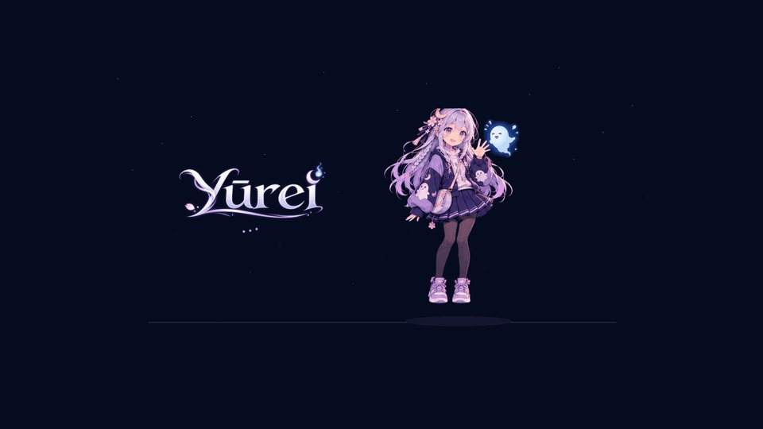
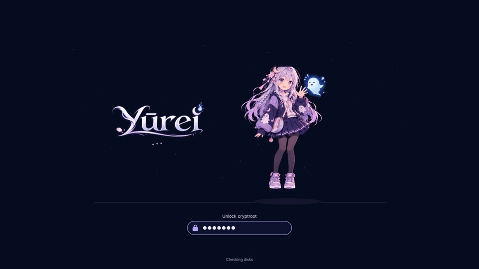
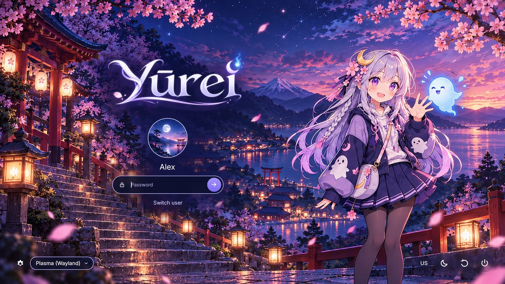

# Boot animation and login screen

Yūrei's branding has two themes, each in its own package:

| Package | What it is | Turn on / off |
|---|---|---|
| `yurei-plymouth-theme` | Boot and shutdown animation: the mascot spots a spirit, chases it, leaps, catches it and waves beside the wordmark. The wave loops for as long as booting takes. | `yurei bootsplash on` / `off` |
| `yurei-sddm-theme` | Login screen: moonlit shrine and sakura, the mascot, the new wordmark, and real controls (password, "Switch user" with an account list, session menu, keyboard layout, sleep/restart/shut down). Accounts without their own picture get the design's moon-over-torii avatar. | `yurei login-screen yurei` / `plasma` |

New installs from the Yūrei ISO get both automatically. The installer step
runs the two commands above, and if either fails, the installation still
completes.

| Boot | Disk unlock | Login |
|---|---|---|
|  |  |  |

## How this fits CachyOS

These are the parts of the system the themes touch, as set up by CachyOS's
installer, which Yūrei uses unchanged:

* **Login manager.** CachyOS uses *plasma-login-manager*, which can't load
  SDDM themes. `yurei login-screen yurei` therefore switches the display
  manager to **SDDM** (installed as a dependency of `yurei-sddm-theme`). It
  remembers the previous display manager, and `yurei login-screen plasma`
  switches back. "Start in Game Mode" (`yurei session game`) keeps working
  with either one.
* **Boot splash.** `yurei bootsplash on` detects how the system boots:
  * initramfs: **mkinitcpio** (adds the `plymouth` hook after `kms`, or after
    `systemd`/`udev`, and always before `encrypt`/`sd-encrypt`) or **dracut**
  * bootloader: **Limine** (`/etc/default/limine`), **systemd-boot** via
    `sdboot-manage`, **GRUB**, or `/etc/kernel/cmdline`, where it adds
    `quiet splash` to the default entry only. Fallback entries stay verbose.

  It then regenerates the initramfs and bootloader entries.
* **Desktop.** KDE Plasma is unchanged; the themes cover only what comes before it.
* **Live ISO.** It keeps CachyOS's login manager and has no Plymouth. The
  themes apply to installed systems.

## Previewing

**Login screen.** This works from your normal desktop, with nothing switched over:

```sh
sudo pacman -S yurei-sddm-theme          # or: cd pkg/yurei-settings && makepkg -si
sddm-greeter-qt6 --test-mode --theme /usr/share/sddm/themes/yurei
```

Close the window to quit. Logging in does nothing in test mode.

**Boot animation.** Without changing how the system boots:

```sh
sudo pacman -S yurei-plymouth-theme
sudo plymouth-set-default-theme yurei     # only selects the theme; no -R, no rebuild
# switch to a text console (Ctrl+Alt+F3), log in, then:
sudo plymouthd; sudo plymouth --show-splash; sleep 12; sudo plymouth --quit
sudo plymouth-set-default-theme -l        # list themes; set your old one back if you like
```

`plymouth ask-for-password` during the preview shows the disk-unlock
prompt, and pressing **Esc** shows the text log.

## Installing and rolling back

```sh
yurei bootsplash on            # takes effect at the next boot
yurei login-screen yurei       # takes effect at the next boot

yurei bootsplash status        # what's configured
yurei login-screen status

yurei bootsplash off           # undo exactly what "on" changed
yurei login-screen plasma      # back to plasma-login-manager
sudo pacman -R yurei-sddm-theme yurei-plymouth-theme   # after rolling back, if you want them gone
```

Nothing is overwritten without a backup:

* Every config file `bootsplash on` edits is copied first to `<file>.yurei-bak`.
* What it changed (hook added, words added to which file, previous theme)
  is recorded in `/var/lib/yurei/bootsplash.state`, so `off` removes only
  those changes and leaves your own edits alone.
* The previous display manager is stored in `/var/lib/yurei/login-screen.previous`.
* The SDDM theme choice lives in its own file,
  `/etc/sddm.conf.d/10-yurei-theme.conf`. It doesn't touch `/etc/sddm.conf`.

### If something goes wrong

* **Black screen instead of the login screen:** press Ctrl+Alt+F3, log in,
  run `sudo yurei login-screen plasma`, then `sudo reboot`. If the `yurei`
  command isn't available, `sudo systemctl enable --force plasmalogin.service`
  does the same thing.
* **The boot animation hides a problem:** press **Esc** during boot to see
  the text log. To skip it for one boot, edit the boot entry in the boot menu
  and delete `splash`. Then run `yurei bootsplash off`.
* **Disk-unlock prompt:** it appears below the animation as a box with a lock
  icon and dots. It stays usable even if the initramfs has no fonts, because
  the box and dots are images, not text.

## Building the assets

The design files in `branding/source/` are the originals:

| File | What it is |
|---|---|
| `Yurei-Boot-Animation.mp4` | The approved motion concept |
| `Yurei-Login-Reference.png` | The approved login design |
| `Yurei-Logo.png` | The approved wordmark |
| `Yurei-Animation-Poses.png` | The character pose sheet |

`branding/build-assets.py` turns them into theme files. It needs ffmpeg,
Pillow, numpy and opencv-python-headless. It:

* removes the "motion concept" caption from every frame
* crops the frames and stores each distinct frame once, with a timeline:
  130 images for 192 frames, stored at 85% size with 128 colours, about
  6 MB in each initramfs
* makes the frame background transparent, so no edge shows at any scaling
* extracts the wordmark onto a transparent background, keeping its glow
* removes the mock-up UI painted into the login design (`Yurei-Login-Reference.png`,
  1672×941). Text and the wordmark are masked by their bright strokes only, so
  the scenery between letters survives. It then upscales the design 2× and
  keeps its avatar picture as the default avatar
* regenerates `overlay/boot/splash.png`, the ISO boot menu, with the new wordmark

Run it again whenever the source art changes.

## What was tested, and what still needs hardware

**Tested in development:**

* **Plymouth.** The real `plymouthd` (version 24.004) ran the theme through
  its X11 renderer in a virtual display (`tests/plymouth_check.py`,
  which also runs in CI). It checks:
  * the full sequence, then the waiting loop
  * the exact background colour, with no frame edge
  * status messages, which disappear 8 s after their last update (Plymouth 24
    never calls a script's hide-message hook)
  * a typed passphrase reaching the caller, with one dot per character
  * the prompt with and without the font plugin
  * shutdown mode going straight to the wave
  * scaling at 1366×768, 1920×1080 and 3840×2160

  With a serial console attached, Plymouth falls back to its text mode, as
  expected.
* **SDDM theme.** It ran in Qt 6.12 with stand-ins for SDDM's objects and
  software rendering (`tests/test_sddm_theme.py`). The tests use real key
  events and cover:
  * wrong and right passwords, with the error message and the field cleared
  * the selected session being passed to login
  * Tab order through every control, Enter and Escape
  * the power buttons, the Caps Lock warning, and the keyboard layout button
  * switching users with Up/Down, through "Switch user" (account list, "Other user…"),
    and typing a username when no users are listed
  * the default avatar picture, and the layout indicator with one or more layouts
  * no QML warnings
  * the controls staying on screen at 16:9, 5:4, 21:9 and portrait

  It uses no GPU-only effects, so it also renders without 3D acceleration.
* **Helpers.** `bootsplash` and `login-screen` ran on fake system roots
  (`tests/test_bootsplash.sh`):
  * Limine, sdboot-manage, GRUB and `/etc/kernel/cmdline`
  * mkinitcpio, including systemd-based and encrypted setups, and dracut
  * Plymouth already configured with another theme
  * idempotence, and rollback restoring the original files byte for byte

**Not yet tested (needs a CachyOS machine):**

* the real SDDM greeter (`sddm-greeter-qt6`) and the switch from
  plasma-login-manager on an installed system
* a real boot: KMS timing, how much of the animation shows before the
  desktop, NVIDIA (needs early KMS: `nvidia_drm.modeset=1`), hybrid graphics
  and multiple monitors
* a LUKS unlock in the real initramfs, and the fonts available there on Arch
* the exact regeneration commands on current CachyOS, for example the name of
  `limine-update`. When a command is missing, the helper says what to run by hand.
* the Calamares installer step end to end

## Art that would improve this

* **Clean login artwork** with no mock-up UI, at least 3840 px wide, ideally
  with the mascot on a separate transparent layer. The current background is
  the 1672×941 design, upscaled. The repaired spots are hidden behind the
  real controls on most screens, but a separate mascot layer would let the
  layout adapt properly to 16:9 and portrait screens.
* **In-between poses** for the run, leap and catch. The animation uses the
  approved video's frames as they are. No new character drawings were
  invented, so the motion is exactly as smooth as the concept. Drop a new
  video or PNG sequence into `branding/source/` and rerun
  `build-assets.py`.
